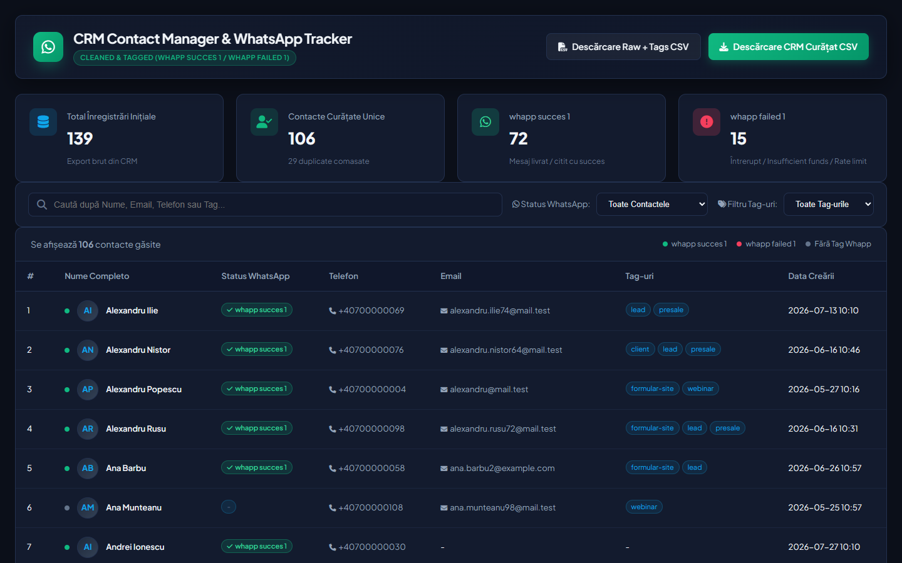

# CRM WhatsApp Cleaner

**Clean a messy CRM contact export, merge duplicates, tag every contact with the result of a WhatsApp bulk send, and browse it all in a zero-dependency dashboard.**

<p align="center"></p>

After a WhatsApp campaign from a CRM (GoHighLevel-style exports), you are left with two files that don't talk to each other: a contact export full of duplicates, test entries and inconsistent formatting, and a bulk-action log saying which messages were delivered. This tool joins them and answers the only question that matters next: **who actually received the message, and who do we need to reach another way?**

## What the cleaner does (`clean_crm.py`)

1. **Parses the WhatsApp bulk log**, including messages that span several lines, and maps each contact id to `whapp succes 1` (delivered/read, or sent without an error) or `whapp failed 1`.
2. **Writes the raw export back with the new tags**, so it can be re-imported into the CRM as-is.
3. **Removes junk**: test emails, placeholder phone numbers, "test QA" businesses, keyboard-mash addresses.
4. **Normalises**: names capitalised (including hyphenated names), emails lower-cased with `.con`/`.cmo` typos fixed, phones converted to E.164 (`0722 123 456`, `(722) 123456`, `40722123456` → `+40722123456`).
5. **Merges duplicates by full name**, keeping the first non-empty phone, email and business across all rows, the earliest creation date, the union of all tags, and the best WhatsApp outcome.
6. **Reports**: `cleaning_report.json` with totals, junk removed, merged duplicates, completeness (phone + email), and WhatsApp success/failure counts.

On the bundled fictional sample: **139 rows → 4 junk removed → 29 duplicates merged → 106 clean contacts**, 80.2% with both phone and email, 72 reached on WhatsApp and 15 failed.

## Run it

```bash
pip install pandas
python clean_crm.py                                   # uses sample/ and writes data/
python clean_crm.py --contacts my_export.csv --log my_bulk_log.csv --out-dir data
python -m http.server 8000                            # then open http://localhost:8000
```

The dashboard (`index.html` + `app.js`, vanilla JS, no build step) reads `data/contacts_cleaned.csv` and `data/cleaning_report.json`: search by name, phone, email or tag, filter by WhatsApp status or tag, paginate, and download the cleaned or the re-tagged raw CSV.

## Expected input

- **Contacts CSV**: `Contact Id, First Name, Last Name, Phone, Email, Business Name, Created, Last Activity, Tags`
- **Bulk log CSV**: rows start with the 20-character contact id. The status is detected from `Delivered`, `Read`, `Sent` and `Message Undeliverable` anywhere in the row.

## Limitations

Duplicates are merged on the normalised full name. That is right for a local business's CRM, but two different people with the same name would be merged, so review the output before re-importing a large list.

## Sample data

Everything in `sample/` and `data/` is generated and fictional: phone numbers in the `+40 700 000 xxx` range, emails on the reserved `.test` and `example.com` domains.

## License

MIT
